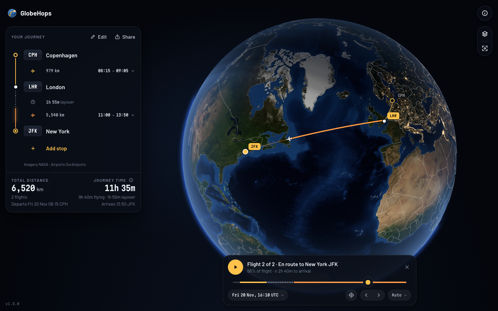
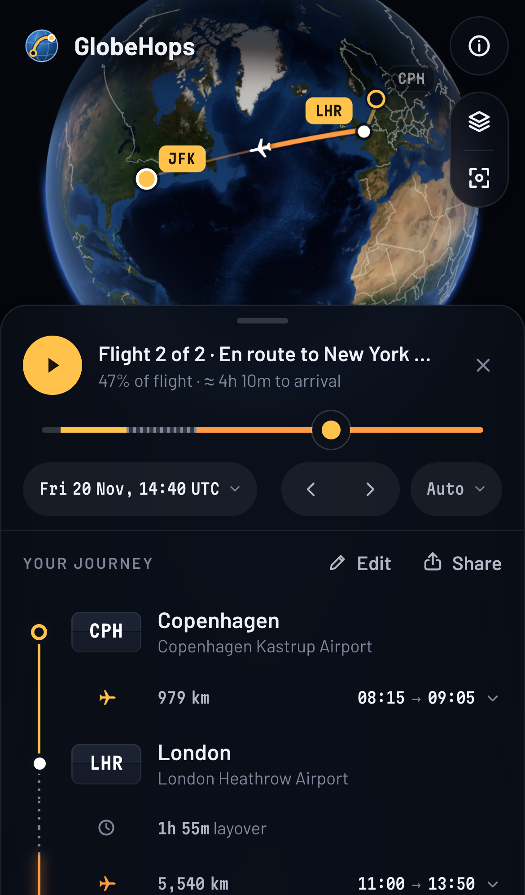

# GlobeHops

**See any air journey as it really curves around the Earth.** GlobeHops draws your flights as great-circle routes on an interactive 3D globe, with distances, estimated flight times and layovers for every connection. Add your flight times if you like, press Play and watch the journey unfold across the sunlit and dark sides of the planet.

**[Open GlobeHops → tmrk.github.io/globehops](https://tmrk.github.io/globehops/)**

It runs in any modern browser on phones, tablets and desktops. There is nothing to install and no account to create. The version you are using is shown in About (ⓘ) and, on larger screens, faintly in the bottom-left corner; [what’s new](RECENT_CHANGES.md) lists every release.

## What you can do

- **Find airports** by city, airport name, IATA or ICAO code, or alternative names. Accents are optional: “malmo” finds Malmö.
- **Plan up to ten stops.** Choose any airport to change it and use “Add stop” to continue the journey. Tap **Edit** to insert, remove or reorder stops (drag or use the keyboard), reverse the whole journey or clear it.
- **Explore the globe.** Drag to rotate and scroll or pinch to zoom; arrow keys and +/− work too. Select a flight in the list or on the globe to fly to it. Routes too wide for one view can be stepped through flight by flight. Country names can be switched on in the display menu (the layers button at the top right); more appear as you zoom in. The button below it re-centres the globe on your route. On phones, drag the journey sheet down to see the whole globe.
- **Set layovers.** Each connection starts at 1h 30m. Change it under the connecting airport, from 30 minutes to three days.
- **Show or hide country borders** in the display menu. They are on by default, with a fainter outline along every coast so land stays easy to read on the night side.
- **Add flight times (optional).** Tap “Add times” on any flight to set its departure and arrival date and time, always in each airport’s local time, with the airport’s time zone shown beside it. Times you leave out are estimated from the ones you enter and shown in place, marked with ≈; tap one to adjust it. GlobeHops warns about impossible or contradictory schedules, a clock time that occurs twice when clocks go back (you choose which one), and a time that doesn’t exist when clocks go forward.
- **Play the journey.** Press Play to watch the plane fly every leg and wait out each connection, with the whole trip compressed into about 15 seconds. Pause, drag the timeline to any moment, jump between flights or pick a fixed speed (0.5, 1 or 2 hours per second). The clock shows your own time, UTC or any airport’s local time.
- **Day and night.** The globe is lit by the Sun for the moment shown: the current time normally, or the moment you play or scrub to. The night side darkens behind a narrow twilight band, following the seasons, and city lights come on after dusk. Turn shading off in the display menu, which also lets you explore any date and time from the globe clock.
- **Switch kilometres and miles** in the display menu. The journey totals at the bottom of the panel show the total distance and number of flights on the left, and the overall journey time with its flying and layover time on the right.
- **Share the journey.** The page address always holds the current route, so you can bookmark it or send it to someone. The Share button copies it or opens your device’s share sheet.

### Route links

Routes use airport codes separated by hyphens: [`?route=CPH-LHR-JFK`](https://tmrk.github.io/globehops/?route=CPH-LHR-JFK). A layover different from the default follows its airport in minutes, e.g. [`?route=LHR-DXB_240-SIN-SYD`](https://tmrk.github.io/globehops/?route=LHR-DXB_240-SIN-SYD) for four hours in Dubai. Flight times are added as local times per airport, numbered by position in the route: `dep1` leaves the first airport, `arr2` reaches the second, and so on, e.g. [`?route=CPH-LHR-JFK&dep1=2026-11-20T08:15&arr3=2026-11-20T13:50`](https://tmrk.github.io/globehops/?route=CPH-LHR-JFK&dep1=2026-11-20T08:15&arr3=2026-11-20T13:50). Unknown codes are reported and skipped. Without a route in the address, GlobeHops reopens your last journey in that browser.

### For AI assistants and agents

GlobeHops publishes a documented, versioned link contract so assistants can build a working visualisation for you: [llms.txt](https://tmrk.github.io/globehops/llms.txt), [capabilities](https://tmrk.github.io/globehops/agent/capabilities.json), the [itinerary JSON Schema](https://tmrk.github.io/globehops/agent/itinerary.schema.json) and [worked examples](https://tmrk.github.io/globehops/agent/examples.json). A local [MCP](https://modelcontextprotocol.io/) server in this repository offers airport search, route calculation, validation, link building and journey timelines using the same code as the website. See [agent integration](docs/AGENT_INTEGRATION.md).

## How the numbers are worked out

- **Distance** is the shortest great-circle path on a spherical Earth (mean radius 6,371.0088 km). Real flights often deviate because of winds, air-traffic control, weather and restricted airspace.
- **Flight time** is an estimate, not a schedule: distance at an average 850 km/h plus 30 minutes for take-off, climb, approach and landing, rounded to five minutes.
- **Total time** adds the layover at each connection to the flight times. When you enter times, your times win and the totals follow them.
- **Time zones** come from each airport’s location (IANA time zones), so daylight saving time, historical changes and the International Date Line are handled. Future dates use today’s time-zone rules, which governments can change.
- **The plane’s position** during playback is an estimate: it moves along the great circle at a pace that follows the simplified climb, cruise and descent profile. It is not a real flight track.
- **Day and night** follow the Sun’s position for the moment shown, calculated with a standard astronomical algorithm accurate to a few hundredths of a degree. The city lights are a 2016 satellite composite, not live.
- **The arcs** follow a simplified flight profile. Each flight climbs to a typical cruising altitude of about 11 km over roughly 20 minutes, holds it, and descends over about the last 25 minutes. Flights too short to reach cruise peak lower. Height is exaggerated 12× so it is visible on the globe. Seen from above, each arc follows its great-circle ground track exactly.

## Privacy

GlobeHops has no accounts or backend. Your route and flight times live only in the page address and in your browser’s local storage, together with your unit, border and day/night preferences. All maps, data and fonts are served with the site.

**Usage statistics are optional.** On your first visit GlobeHops asks whether it may use Google Analytics, in a panel at the bottom of the screen that waits for your answer. Nothing is loaded from Google unless you choose Allow; Deny is remembered too, and you can change your mind at any time under About → Privacy, which also removes the analytics cookies. With your permission, Google Analytics counts visits and a few actions (sharing a link, playing a journey) using first-party cookies. It receives the bare site address and a fixed page title, never your airports, dates or times; advertising features and Google signals are off. Browsers that send Global Privacy Control or Do Not Track are never asked and never measured.

## Sources and credits

- **Earth imagery:** [Blue Marble Next Generation](https://science.nasa.gov/earth/earth-observatory/blue-marble-next-generation/base-topography-bathymetry/), July 2004 composite with topography and bathymetry. Credit: NASA Earth Observatory (Reto Stöckli, NASA GSFC). It is a cloud-free composite, not a live view. GlobeHops is not affiliated with or endorsed by NASA.
- **City lights:** [Earth at Night (Black Marble) 2016](https://science.nasa.gov/earth/earth-observatory/earth-at-night/maps/). Credit: NASA Earth Observatory images by Joshua Stevens, using Suomi NPP VIIRS data from Miguel Román, NASA’s Goddard Space Flight Center.
- **Airports:** [OurAirports](https://ourairports.com/data/), public domain. The airport list is checked for updates daily.
- **Time zones:** derived from [timezone-boundary-builder](https://github.com/evansiroky/timezone-boundary-builder) 2026f. Contains information from timezone-boundary-builder, which is made available under the [Open Database License (ODbL)](https://opendatacommons.org/licenses/odbl/1-0/); boundaries © OpenStreetMap contributors. The derived airport time-zone table is published in this repository under the same licence.
- **Country borders and coastlines:** [Natural Earth](https://www.naturalearthdata.com/) 1:50m Admin 0 boundary lines (land) and coastline, version 5.1.2, public domain. Natural Earth shows de facto boundaries; their depiction implies no position on any territorial dispute.
- **Typefaces:** [Barlow](https://github.com/jpt/barlow) by Jeremy Tribby and [Martian Mono](https://github.com/evilmartians/mono) by Evil Martians, both under the SIL Open Font License 1.1.
- **Software:** built with [React](https://react.dev/) and [Three.js](https://threejs.org/), both MIT licensed.
- **Usage statistics (optional):** [Google Analytics](https://marketingplatform.google.com/about/analytics/), only with your consent; see Privacy above.

How each source is selected, processed and licensed is documented in [data sources](docs/DATA_SOURCES.md) and [third-party notices](THIRD_PARTY_NOTICES.md).

## Licence

The GlobeHops code is [MIT licensed](LICENSE). Imagery, data and fonts keep their own terms, listed above.
